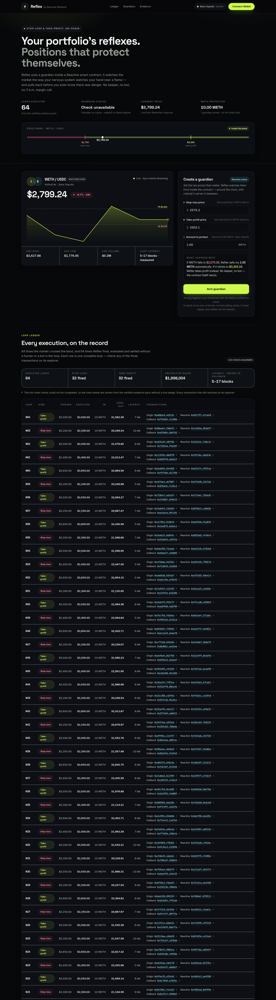

# Reflex — a stop-loss & take-profit guardian that reacts so you don't have to

**Live demo: [godson-droid.github.io/reflex](https://godson-droid.github.io/reflex/)** — the web app, running live and reading the deployed contracts on-chain.

**Reflex** is an autonomous guardian for a Uniswap-V2-style liquidity position.
You arm it once with a price band — a stop-loss floor and a take-profit ceiling —
and then you can walk away. A reactive contract on **Reactive Lasna** watches the
pair's price around the clock; the moment the price touches your floor or your
ceiling, Reflex executes the protective swap on the destination chain by itself.
No keeper bot to babysit, no server to keep alive, no 3 a.m. price alerts: the
reaction is a property of the network, not of your infrastructure.

> Built for the **Reactive Omni Buildathon** (DoraHacks), track
> **Every Second Counts**.
>
> **Live on testnet, loop proven on-chain twice:** stop-loss fired at
> 2,084.38 USDC/WETH (10 WETH → 19,187.10 USDC) and take-profit at 3,427.98
> (10 WETH → 30,887.68 USDC). Full transaction chains are below. The deployment
> is currently re-armed and **watching**.



## The problem

A stop-loss that depends on a person (or a person's server) is not a stop-loss.
Retail DeFi users who hold a token on an AMM have no native way to say "sell if
this drops 10%, sell if it rises 10%" — the pair contract only swaps when
someone sends a transaction. Centralized exchanges offer conditional orders
because a server watches prices for you; on-chain, you are the server. Reflex
moves that watcher into a reactive smart contract: the condition and the
execution are both on-chain, verifiable, and always awake.

## How the loop works

```
 Base Sepolia (origin)                Reactive Lasna                 Base Sepolia (destination)
┌───────────────────┐   Sync event   ┌────────────────────┐  callback  ┌─────────────────────┐
│ ReflexPair        │ ─────────────▶ │ ReflexGuardian     │ ───────────▶ │ ReflexCallback      │
│ reserves move on  │  (price data)  │ prices the Sync,   │  request     │ re-checks the price │
│ every swap/mint   │                │ checks the band,   │  (V_1_0)     │ on-chain, swaps the │
│                   │                │ fires once         │              │ owner's tokens,     │
└───────────────────┘                └────────────────────┘              │ proceeds → owner    │
                                                                          └─────────────────────┘
```

1. **Origin event.** Every swap or liquidity change on `ReflexPair` updates its
   reserves and emits `Sync(reserve0, reserve1)` — the standard V2 price signal.
2. **Reactive transaction.** `ReflexGuardian` (on Lasna) is subscribed to the
   pair's `Sync` events. For each one it derives the spot price
   (`reserveBuy / reserveSell`, 1e18-scaled) and compares it with the armed band.
   Prices inside the band cost a few gas and nothing else happens.
3. **Callback.** On the first breach, the guardian marks itself *Triggered*
   (one-shot: it cannot fire twice) and calls `SYSTEM.requestCallbackV_1_0`
   with a payload for `ReflexCallback.executeGuard`. The payload's first
   argument is the `address(0)` placeholder Reactive overwrites with the
   guardian's address.
4. **Execution.** The callback arrives through Base Sepolia's callback proxy.
   `ReflexCallback` authenticates it twice (proxy as caller, guardian as the
   injected sender), **re-derives the price from live reserves** — if the market
   already recovered, it aborts and stays armed — then pulls the owner's tokens
   into the pair, swaps them at the constant-product price, and sends the
   proceeds directly to the owner. The execution (kind, observed vs. executed
   price, amounts) is stored on-chain and emitted as an event.

## Design choices worth noting

- **One-shot by default.** A stop-loss that re-fires on every `Sync` after the
  breach would keep selling into a falling market. Reflex fires once, then
  waits for the owner to deliberately re-arm (guardian `rearm()` + callback
  `rearm()` with a matching band).
- **Execution re-verification.** The Lasna-side observation is evidence, not
  proof. The callback re-prices from live reserves and aborts if the condition
  no longer holds or the trigger kind changed — protection against stale or
  manipulated triggers, and it means a recovered market never gets sold into.
- **Inclusive boundaries.** Touching the floor *is* the stop-loss; touching the
  ceiling *is* the take-profit. A guardian exists to act at the boundary.
- **Abort ≠ revert.** Aborted executions return cleanly with an
  `ExecutionAborted` event. A reverting callback is still billed by the proxy
  and surfaces only as a `CallbackFailure`; an abort is recorded, explained,
  and leaves the guard armed.
- **No router dependency.** The callback swaps directly against the pair using
  the constant-product formula (0.3% fee), so the execution path has exactly
  one external dependency: the pair itself.
- **Shared math.** `PriceMath` (spot price, band evaluation, swap output) is
  used identically on both chains, so "triggered" means the same thing
  everywhere.

## Contracts

| Contract | Chain | Role |
|---|---|---|
| `ReflexPair` | Base Sepolia | Minimal V2-style pair; the price origin. Emits `Sync` on every reserve change. |
| `ReflexGuardian` | Reactive Lasna (5318007) | Reactive contract. Subscribes to the pair's `Sync`, prices it, fires one callback per arming. |
| `ReflexCallback` | Base Sepolia | Callback contract. Authenticates, re-verifies, swaps, records. |
| `PriceMath` | both | Shared library: spot price, band evaluation, swap output. |
| `MockERC20` | Base Sepolia | Test asset for the testnet deployment. |

One guardian protects one position (one pair, one sell direction, one amount).
Several positions → several guardians, each small, independently funded and
independently auditable.

## Live deployment (testnet, 2026-11-15)

All contracts are verified on Sourcify with `exact_match` (creation + runtime).
Deployer / position owner: `0xfe332e01162D5408211DAAC305254E2456e5e437`
(testnet-only wallet). Explorers: Base Sepolia —
https://sepolia.basescan.org · Lasna — https://lasna.reactscan.net

| Contract | Chain | Address | Deploy tx |
|---|---|---|---|
| MockERC20 "WETH" (pair token0) | Base Sepolia (84532) | `0x057A04Ad09c9A1fD83088F9863E81b181f8a4D9A` | `0x407a9ee42a98d4fbcf15927b6d650cba07d81e4eb89880802a5c9c224637d672` |
| MockERC20 "USDC" (pair token1) | Base Sepolia (84532) | `0xA37786bDdda4FA1039291A25cC9043669Fb42DFd` | `0x04e697e4863327a20c55e6783c664efec69335424b3ed84ace23adae76eeccd4` |
| ReflexPair | Base Sepolia (84532) | `0x1bC9aB7D74f12897A44717B9497478e2b01CE2D6` | `0xe6b5616cb2d5839615f8ba489e8e0d04c2aba0b4667b4ae1bb09af3ac8068183` |
| ReflexGuardian | Reactive Lasna (5318007) | `0x057A04Ad09c9A1fD83088F9863E81b181f8a4D9A` | `0x5f15f812c97023520e4c981feb0cf31e9d0399d8cbc90c34f0c908de7dee48cf` |
| ReflexCallback | Base Sepolia (84532) | `0x7858F9f40dBdB2Edfd32c781a98c69294cd009d0` | `0xc92e7d7c50886af944c8db74dc71ecf9c93946caef73c54a8518d5fed4893777` |

Note: the WETH token (Base Sepolia) and ReflexGuardian (Lasna) share an address
because both were the deployer's nonce-0 transaction on their respective
chains. They are different contracts on different networks.

**Configuration:** pair seeded with 100 WETH / 300,000 USDC → starting price
**3,000 USDC/WETH**. Guard band: **stop-loss 2,700 · take-profit 3,300**,
protected amount **10 WETH**. Guardian funded with 5 lREACT; callback funded
with Base Sepolia ETH (callbacks are billed to the recipient).

### The loop, run twice (execution evidence)

**Run 1 — stop-loss.** A 20 WETH sell moved the pair's price through the floor:

| Step | Chain | Tx |
|---|---|---|
| Origin swap (Sync prints 2,084.38) | Base Sepolia, block 59029446 | `0x790b838a0f612a4bf1f1cee07e07da3c90b91662d3298e638b426bc02fa462db` |
| Reactive transaction (guardian `react()` → `Triggered(kind=1, price=2084.3755)`) | Lasna, block 8391301 | `0x6b8c818cf5bcab84d1baf0b5a6c6d3663eb88d76f2d0b08c1171b68b2c0b1e0f` |
| Callback execution (protective swap settles) | Base Sepolia, block 59029451 | `0xec6a18cf3f7eadf1538dd6f97fca69af09a5f2812c676bcfc55d8fba13d5efa7` |

On-chain `Execution` record: kind = 1 (stop-loss), observed = executed price
2,084.3755 USDC/WETH, amountIn = 10 WETH, **amountOut = 19,187.096 USDC** paid
to the owner.

**Run 2 — take-profit** (after re-arming both contracts). A 90,000 USDC buy
moved the price through the ceiling:

| Step | Chain | Tx |
|---|---|---|
| Origin swap (Sync prints 3,427.98) | Base Sepolia, block 59029831 | `0x8bdab6d3447de2ce89b8217c96d362c2d6ed0bd47f4e2d138de576e99796685a` |
| Reactive transaction (`Triggered(kind=2, price=3427.9777)`) | Lasna, block 8391374 | `0xa3966763ede1513e97e29440535603f75d26b4ee10c03012e4f36aab9a6a91b8` |
| Callback execution | Base Sepolia, block 59029838 | `0x259cef4b7b45be065b058fea2a3778f0e5ed31e4bb5c41f5bc0d6897a88d1791` |

On-chain `Execution` record: kind = 2 (take-profit), observed = executed price
3,427.9777, amountIn = 10 WETH, **amountOut = 30,887.684 USDC**.

After run 2 both contracts were re-armed, so the live deployment is back in
**Watching** state (guardian `Armed`, callback `Armed`, price inside the band).
Full deployment record, funding path and balances: [contracts/DEPLOYMENT.md](contracts/DEPLOYMENT.md).

## Repository layout

```
reflex/
├── contracts/          Foundry project (Solidity 0.8.29)
│   ├── src/            ReflexPair, ReflexGuardian, ReflexCallback, PriceMath, MockERC20
│   ├── test/           31 unit tests + mock system contract / callback proxy
│   └── DEPLOYMENT.md   Full testnet deployment record
├── web/                Vite + React + TypeScript UI, wired live to the deployment
│   ├── src/lib/chain.ts  CONTRACTS config + live reads
│   └── docs/screenshots/
├── LICENSE             MIT
└── README.md
```

## Run it

**Contract tests** (31 tests, all passing):

```bash
cd contracts
forge test
```

Unit tests etch a mock system contract onto the real system-contract address
(`0x8888888888888888888888888888888888888888`), so the guardian's constructor
subscription and callback requests are exercised end-to-end locally, and a mock
callback proxy exercises the callback's two-layer authentication.

**Web UI:**

```bash
cd web
npm install
npm run dev      # or: npm run build && npm run preview
```

The UI reads the live deployment: `CONTRACTS` in `web/src/lib/chain.ts` carries
the addresses above, and price plus guardian/callback state are read directly
from the contracts. The two recorded loop runs are presented with their real
transaction hashes.

## Deployment runbook (testnet)

Order matters — the callback immutably authorizes the guardian's address, and
the guardian needs the callback's address before it can fire:

1. Deploy `MockERC20` ×2 and `ReflexPair` on Base Sepolia; seed liquidity
   (`transfer` both tokens to the pair, then `mint`).
2. Deploy `ReflexGuardian` on Lasna (funded with lREACT — it pays for its own
   reactive transactions).
3. Deploy `ReflexCallback` on Base Sepolia with the chain's callback proxy
   (`0x476F44b11F5C942c58f4c8E3d0300E5710743585`), the guardian's address, the
   pair, and the band; fund it with Base Sepolia ETH.
4. On the guardian: `setCallback(callback)`, then
   `configure(sellToken0, floor, ceiling)`.
5. Owner approves `ReflexCallback` to spend the sell amount of the sold token.
6. Move the pair's price across the band (a swap) and watch the loop close:
   `Sync` → guardian `Triggered` event → callback `Executed` event.

Getting lREACT: send Sepolia ETH (≤ 5 ETH per transaction, 1 ETH → 100 lREACT)
to the Reactive faucet — Ethereum Sepolia
`0x9b9BB25f1A81078C544C829c5EB7822d747Cf434` or Base Sepolia
`0x2afaFD298b23b62760711756088F75B7409f5967` — calling
`request(yourLasnaAddress)`. (Addresses per the official docs,
dev.reactive.network/reactive-mainnet.)

## Tech stack

- **Contracts:** Solidity 0.8.29, Foundry (forge-std), Reactive Network's
  `reactive-lib-omni`; Reactive Lasna (chain 5318007) + Base Sepolia (84532).
- **Web:** React 19, TypeScript, Vite, Tailwind CSS, ethers v6.
- **Verification:** Sourcify exact-match on all five deployed contracts.

## License

MIT — see [LICENSE](LICENSE). The `reactive-lib-omni` dependency is Reactive
Network's library; the Uniswap V2 pair *interface conventions* (event
signatures and the swap calling convention) are used for interoperability,
while every contract in this repo is an original implementation written for
this project.
